# Data model

Splitfoolish keeps everything in one Cloudflare D1 (SQLite) database. Accounts come
from Cloudflare Access, which signs people in by email, so an email address is the
account key everywhere.

```mermaid
erDiagram
    splits ||--o{ split_members : "shared with"
    splits ||--o{ change_receipts : "saves noted"
    splits ||--o{ mcp_receipts : "agent writes noted"
    splits ||--o{ split_invites : "pending invites"
    splits ||--o{ people : "in the bill"
    splits ||--o{ items : "bought"
    splits ||--o{ attachments : "photos"
    splits |o--o| people : "settle up through"
    splits ||--o| split_pictures : "pictured by"
    people ||--o{ items : "paid for"
    items ||--|{ item_participants : "split between"
    people ||--o{ item_participants : "shares in"
    items ||--o{ attachments : "receipts"
    splits ||--o{ payments : "paid back"
    people ||--o{ payments : "paid / was paid"
    items ||--o{ payments : "settled by"
    attachments ||--|| attachment_data : "bytes"
    profiles ||--o| user_settings : "prefers"
    profiles ||--o| avatars : "pictured by"
    profiles ||--o{ payment_methods : "paid back by"
    profiles ||--o{ payment_qr_codes : "QR codes to scan"

    splits {
        text id PK
        text name
        text currency "ISO 4217, e.g. MYR"
        text distributor_person_id FK "null: fewest transfers"
        text invite_token UK "share link"
        text converting_from "while items are converted to a new currency"
        int converting_since
        int created_at
        int updated_at
    }
    split_members {
        text split_id PK, FK
        text email PK "the account"
        text role "owner or editor"
        text share_token UK "a member's own share link"
        int sort_position "their own order for My splits; null comes first"
        int archived_at "null: in My splits, not the archive"
        int joined_at
    }
    change_receipts {
        text split_id PK, FK
        text email PK "the account that sent it"
        text change_id PK "the app's id for the change"
        text fingerprint "the change as sent"
        int saved_at "kept 90 days"
    }
    mcp_receipts {
        text email PK "the account the agent acts as"
        text request_id PK "the agent's id for the request"
        text fingerprint "which tool, split, expense and fields"
        text tool
        text split_id FK
        text expense_id
        int saved_at "kept with the split"
    }
    write_guards {
        int member "never a row: NOT NULL refuses a write whose check failed"
        int currency
    }
    split_invites {
        text id PK
        text split_id FK
        text email
        text invited_by "whose link it came from"
        int needs_approval "1: asked through a member's link"
        int created_at
        int expires_at
    }
    people {
        text id PK
        text split_id FK
        text name UK "unique per split"
        text member_email "the account this person is, if linked; unique per split"
        int position
    }
    payments {
        text id PK
        text split_id FK
        text from_person_id FK "who paid"
        text to_person_id FK "who was paid"
        text item_id FK "the item it settles, if one; cleared when it goes"
        int amount_cents "in the split's currency"
        int created_at "when it was paid"
        text notes
        text original_currency "as items: what was paid, and the rate, when in another currency"
        int original_cents
        real rate
        text rate_source
        int rate_at
    }
    items {
        text id PK
        text split_id FK
        text name
        int cost_cents
        text payer_id FK
        text split_mode "equal, shares or exact"
        text category
        text notes "free text, up to 2000 characters"
        int position
        int created_at
        text original_currency "null: entered in the split's currency"
        int original_cents "as typed, in original_currency"
        real rate "original to split currency, as saved"
        text rate_source "wise, frankfurter or manual"
        int rate_at
    }
    item_participants {
        text item_id PK, FK
        text person_id PK, FK
        int shares "for split_mode shares"
        int exact_cents "for split_mode exact"
        int original_exact_cents "as typed, for items in another currency"
    }
    attachments {
        text id PK
        text split_id FK
        text item_id FK "null: a photo of the whole split"
        text content_type
        int size
        text uploaded_by
        int created_at
    }
    attachment_data {
        text id PK, FK
        blob data
    }
    split_pictures {
        text split_id PK, FK
        text content_type
        int version "changes with each picture"
        blob data
    }
    profiles {
        text email PK
        text display_name
        int created_at
        int updated_at
    }
    user_settings {
        text email PK, FK
        text theme "dark, light or auto"
        text accent
        text last_currency "the currency the last new split used"
        text default_currency "null: use last_currency"
        text rate_preference "wise or ecb (Frankfurter)"
        int sidebar_open
        text items_view "card or table"
        text items_group_by "none, day, week, month, payer or category"
        text items_sort_key "date, name, payer or amount"
        text items_sort_dir "asc or desc"
        int updated_at
    }
    avatars {
        text email PK, FK
        text content_type
        int version "changes with each picture"
        blob data
    }
    payment_methods {
        text id PK
        text email FK
        text type "from a fixed list, or Other named freely"
        text detail "number, ID or link; empty for Cash"
        text bank "bank transfers: any bank"
        text account_name "bank transfers: optional"
        int position
        int is_preferred "at most one per account"
    }
    payment_qr_codes {
        text method_id PK "a payment_methods id; may come first"
        text email FK
        text content_type
        int version "changes with each image"
        blob data
    }
```

## Why it's shaped this way

- **A split's bill.** `people`, `items` and `item_participants` are separate tables, so
  an edit touches only the rows it changes and items refer to people by id. Money is
  whole cents, so totals always add up.
- **What others see and what only you see.** `profiles` holds what people in your
  splits see: your display name, with your picture in `avatars` and how to pay you in
  `payment_methods`. `user_settings` holds private preferences (theme, accent, the
  default currency, how items are shown), which follow you between devices.
- **Large values live apart.** Picture and photo bytes sit in `avatars`,
  `split_pictures`, `attachment_data` and `payment_qr_codes`, so reading names or
  listing splits, photos and payment methods never loads images. A QR code is uploaded
  before its payment method is saved, so it isn't tied to the method's row; codes whose
  method is gone are dropped the next time methods are saved.
- **Other currencies.** An item entered in another currency keeps what was typed
  (`original_currency`, `original_cents`) and the rate it was converted at, while
  `cost_cents` holds the amount in the split's currency, worked out once by the server
  when the item is saved. Totals never drift as rates move, and settling up only ever
  sees one currency. Editing an item without changing its amount keeps its rate.
- **Changing a split's currency.** The new currency is saved at once and the items
  are converted in the background (`converting_from` and `converting_since` mark it).
  Plain items become "paid in the old currency", items paid in the new one become
  plain again, so changing back restores the exact amounts. Items can't be added or
  edited until it's done; the app holds such changes and sends them again.
- **Shared, not per person.** Who to route payments through is a property of the split
  (`splits.distributor_person_id`), so everyone in it sees the same transfers.
- **Payments are their own fact.** One person paying another back is a `payments` row,
  not an item: balances subtract it and the split's total ignores it. It may name the
  item it settles, for context only; when that item goes, the payment stays, untied.
  Like an item, one paid in another currency keeps what was paid and the rate on its
  day, and is converted with the split. Someone who made or received a payment can't be
  removed until it is.
- **Deleting cleans up.** Deleting a split removes its members, invites, people, items,
  payments, picture, photos and photo bytes. Deleting an item removes its receipts and
  unties its payments. Removing a person who was the settle-up route sets the route
  back to none.
- **Joining.** Opening the share link doesn't join you: it gives you a `split_invites`
  row (one per person per split, so opening it again changes nothing) that waits in
  Invites. Accepting deletes it, adds you to `split_members` and puts you in the bill: a
  guest with your name becomes you (so someone who was removed and comes back gets
  their old entry), otherwise a new `people` row is added. Declining or the owner
  withdrawing it deletes it; an expired one is ignored and replaced if you open the
  link again.
- **Sharing as a member.** Members have their own link (`split_members.share_token`).
  Opening it makes the same `split_invites` row with `needs_approval` set: it waits in
  the owner's Invites, who approves (adding you as if you'd accepted) or declines.
  You see it as waiting and can withdraw it. Opening the owner's link as well turns
  it into a plain invite; a plain one never becomes a request again. Resetting the
  link changes every member's link too.
- **Removing someone.** When the owner takes an account out of a split, its
  `split_members` row goes, the person it was in the bill stays as a guest
  (`people.member_email` cleared), and `splits.invite_token` changes so the old link
  can't bring them back. Changing the link, by reset or removal, also withdraws the
  invites picked up from it. Only the owner changes `people`; anyone in the split can
  change `items`.
- **Saves are noted, so a retry counts once.** `change_receipts` keeps each change the
  app sent by its id, with a fingerprint of it, for 90 days (every save drops the
  split's older ones); `mcp_receipts` keeps an agent's expense writes by request id
  for as long as the split. Each is written in the batch that saves the change, so
  the receipt exists exactly when the change was saved. `write_guards` has no rows:
  a save inserts a NULL into it when a check made in its batch fails, and NOT NULL
  undoes the batch.
- **Lazy profiles.** A profile row is made the first time someone saves a setting,
  name, picture or payment method; until then the defaults apply. Emails in
  `split_members`, `split_invites` and `people.member_email` don't reference
  `profiles`, because someone can be invited, or join a split, before they have one.

## Indexes

Every index, and the query it is for. The primary keys above serve lookups by id. A
split's people, items, photos and receipts are read by `split_id` in the order shown;
SQLite reads an index in its own order, so the sort costs nothing, and `rowid`, the
tie-breaker, is the implied last key of every index.

| Index                                                    | Serves                                                       |
| -------------------------------------------------------- | ------------------------------------------------------------ |
| `split_members_by_email`                                 | My splits, and every "which splits am I in" join             |
| `split_members_by_share_token` (unique)                  | Opening a member's share link                                |
| `split_invites_by_email`                                 | Someone's pending invites                                    |
| `people_by_split_position`                               | A split's people in order; the next position for a new one   |
| `people_member_email` (unique, where linked)             | One person per account in a split; the account's own person  |
| `items_by_split_position`                                | A split's items in order; the next position for a new one    |
| `items_by_payer`                                         | Removing a person: what they paid for                        |
| `item_participants_by_person`                            | Removing a person: the items they share                      |
| `payments_by_split`, `_by_from`, `_by_to`, `_by_item`    | A split's payments; whether a person or item has any         |
| `attachments_by_split_created_at`                        | A split's photos, oldest first                               |
| `attachments_by_item`                                    | An item's receipts, and deleting them with it                |
| `payment_methods_by_email` (email, position)             | Someone's payment methods in order                           |
| `one_preferred_payment_method` (unique, where preferred) | At most one preferred method per account                     |
| `payment_qr_codes_by_email`                              | Dropping codes whose method is gone                          |
| `mcp_receipts_split`                                     | Deleting a split's agent receipts with it                    |
| `change_receipts_by_split_saved_at`                      | Dropping a split's receipts older than 90 days on every save |

My splits (`worker/splits/summaries.ts`) reads the person's splits and their whole
bills, for totals and balances, in one batch; the agent's `list_splits` reads one page
of them, cut in the database. Searching items by name is a `LIKE '%text%'` over the
person's splits, which no index on the name can narrow.
