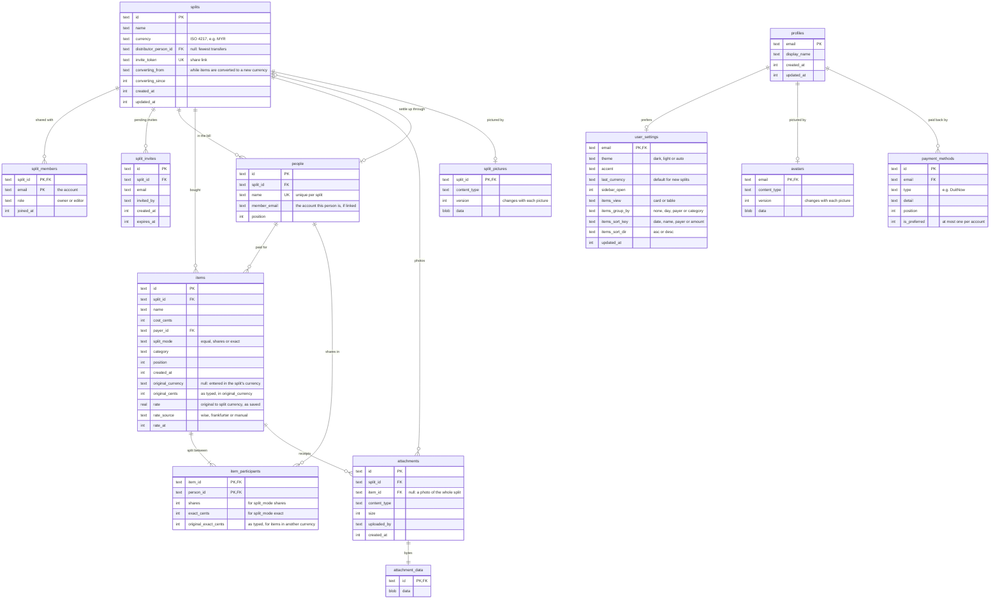

# Data model

Splitfoolish keeps everything in one Cloudflare D1 (SQLite) database. Accounts come
from Cloudflare Access, which signs people in by email, so an email address is the
account key everywhere.

## Why it's shaped this way

- **A split's bill.** `people`, `items` and `item_participants` are separate tables, so
  an edit touches only the rows it changes and items refer to people by id. Money is
  whole cents, so totals always add up.
- **What others see and what only you see.** `profiles` holds what people in your
  splits see: your display name, with your picture in `avatars` and how to pay you in
  `payment_methods`. `user_settings` holds private preferences (theme, accent, the
  default currency, how items are shown), which follow you between devices.
- **Large values live apart.** Picture and photo bytes sit in `avatars`,
  `split_pictures` and `attachment_data`, so reading names or listing splits and
  photos never loads images.
- **Other currencies.** An item entered in another currency keeps what was typed
  (`original_currency`, `original_cents`) and the rate it was converted at, while
  `cost_cents` holds the amount in the split's currency, worked out once by the server
  when the item is saved. Totals never drift as rates move, and settling up only ever
  sees one currency. Editing an item without changing its amount keeps its rate.
- **Changing a split's currency.** The new currency is saved at once and the items
  are converted in the background (`converting_from` and `converting_since` mark it).
  Plain items become "paid in the old currency", items paid in the new one become
  plain again, so changing back restores the exact amounts. Items can't be added or
  edited until it's done; the app holds such changes and sends them again.
- **Shared, not per person.** Who to route payments through is a property of the split
  (`splits.distributor_person_id`), so everyone in it sees the same transfers.
- **Deleting cleans up.** Deleting a split removes its members, invites, people, items,
  picture, photos and photo bytes. Deleting an item removes its receipts. Removing a person who
  was the settle-up route sets the route back to none.
- **Joining.** Opening the share link doesn't join you: it gives you a `split_invites`
  row (one per person per split, so opening it again changes nothing) that waits in
  Invites. Accepting deletes it, adds you to `split_members` and puts you in the bill: a
  guest with your name becomes you (so someone who was removed and comes back gets
  their old entry), otherwise a new `people` row is added. Declining or the owner
  withdrawing it deletes it; an expired one is ignored and replaced if you open the
  link again.
- **Removing someone.** When the owner takes an account out of a split, its
  `split_members` row goes, the person it was in the bill stays as a guest
  (`people.member_email` cleared), and `splits.invite_token` changes so the old link
  can't bring them back. Changing the link, by reset or removal, also withdraws the
  invites picked up from it. Only the owner changes `people`; anyone in the split can
  change `items`.
- **Lazy profiles.** A profile row is made the first time someone saves a setting,
  name, picture or payment method; until then the defaults apply. Emails in
  `split_members`, `split_invites` and `people.member_email` don't reference
  `profiles`, because someone can be invited, or join a split, before they have one.
